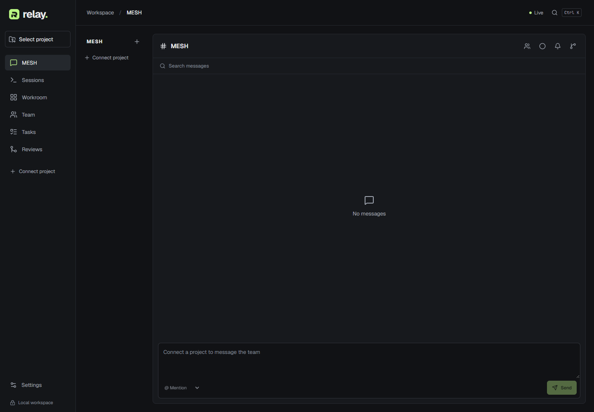

<div align="center">
  
  <h1>RELAY</h1>
  <p><strong>Room for Execution, Local Agents & Yield</strong></p>
</div>

RELAY là workspace chạy trên máy cá nhân để nhiều tài khoản Codex cùng làm một dự án. Nhập một prompt: cả team đề xuất, lead tổng hợp workflow, hệ thống chia việc theo khối lượng ước lượng và tự chạy các task đủ điều kiện. Mỗi tài khoản có hồ sơ riêng; mỗi task thực thi có Git worktree và hàng đợi review.

Phiên bản **0.2** bổ sung **MESH**, session Codex tương tác chạy bằng CLI/App Server thật, nhiều session trên một account, quota chung, checkpoint Git trước handoff và recovery có giữ khóa. [Hướng dẫn nền tảng](docs/FOUNDATION.md) mô tả các quy tắc và phạm vi đã triển khai.

Mở [NoSleepClub RELAY](https://nosleepclub-relay.vercel.app). Nút **Hướng dẫn** trong web có popup tiếng Việt, minh họa và tour trỏ vào từng thao tác; có thể bỏ qua hoặc xem lại. [Chi tiết hướng dẫn trong web](docs/ONBOARDING.md).

Ứng dụng dùng **Codex App Server chính thức**, với đăng nhập ChatGPT. Không yêu cầu OpenAI API key, không sao chép phiên đăng nhập của Codex desktop và không giả lập hạn mức thuê bao. Bạn tự đăng nhập từng tài khoản trong tab **Team**. Các tài khoản phải là những tài khoản bạn được phép sử dụng; từng tài khoản vẫn chịu hạn mức và điều kiện của gói tương ứng.



## Chạy nhanh

Yêu cầu: **Node.js 24.22.1 trở lên**, Git và Codex CLI. RELAY đã được kiểm tra với `codex-cli 0.166.0-alpha.5.1`; App Server có các phần experimental nên phiên bản khác cần được xác minh. Ứng dụng tìm CLI trên PATH; trên Windows còn nhận diện bản Codex đi kèm desktop app ở thư mục cài đặt mặc định.

```sh
npm ci
npm run build
npm start
```

Mở **http://127.0.0.1:4317**. Trên Windows, có thể chạy `start-relay.cmd` sau khi cài dependencies. Launcher dùng Node 24.22.1 qua npm nếu Node hệ thống chưa được cập nhật; nó không thay đổi Node toàn máy.

Phát triển giao diện: `npm run dev`, rồi mở http://127.0.0.1:5173. Chạy kiểm thử: `npm test`. Kiểm tra cả TypeScript, tests và build: `npm run check`.

Nếu Node hệ thống cũ, chạy công cụ bằng runtime riêng:

```sh
npm exec --yes --package=node@24.22.1 -- node node_modules/vite/bin/vite.js build
npm exec --yes --package=node@24.22.1 -- node --import tsx server/index.ts
```

## Thử với bốn tài khoản

Để dùng nền tảng mới:

1. Thêm project Git trong Settings, tạo hồ sơ và tự đăng nhập trong Team.
2. Mở **MESH** để trò chuyện theo project. Tin người dùng được nhận việc một lần và chuyển tới session chỉ đọc khi có account/quota phù hợp; agent không tự mở vòng trả lời nhau. `!!` chỉ đánh dấu lệnh từ người dùng thật.
3. Trong **Sessions**, mở session theo account, chọn read-only hoặc scope ghi file và gửi prompt. Mỗi cửa sổ có output/tool events thật, follow-up/steering và Pause/Stop. Có thể pop out một session hoặc mở demo bằng URL localhost. Đây là rich console của runtime thật; chưa nhúng native TUI/ứng dụng Codex Desktop.
4. Trong panel Usage, refresh quota. Còn ≤50% ở một cửa sổ áp dụng sẽ ngừng giao việc và pause các session của account. Nếu cần dùng phần dự trữ, người dùng cấp quyền theo account/project, mức sàn và thời hạn. Quota chưa biết/quá cũ không được coi là còn đầy.
5. Trước code handoff, cấu hình owner GitHub/name/email trong Team và origin của project. Handoff dừng source, commit progress với author đã cấu hình, push và xác nhận remote SHA. Người nhận đọc/ACK, rồi tiếp tục từ session được chuyển quyền. Push lỗi giữ khóa và hiện Needs you.
6. Sau gián đoạn, kiểm tra PID cũ, xác nhận worker đã dừng rồi Recover; Resume là bước riêng. Database migration giữ hồ sơ, task và lịch sử cũ.

Luồng team workflow từ bản trước vẫn dùng được:

1. Trong **Settings**, thêm đường dẫn tuyệt đối tới một Git repository đã có commit đầu tiên. Đặt mục tiêu chung cho dự án. Repository đang mở trong editor khác vẫn sử dụng được; nhánh chính cần sạch trước khi tích hợp.
2. Trong **Team**, tạo bốn hồ sơ, ví dụ Atlas / Vega / Echo / Nova, rồi chọn vai trò. Đây là nhãn bạn đặt, không phải tài khoản đã được tạo sẵn.
3. Đăng nhập lần lượt bằng **Sign in with ChatGPT** hoặc device code. Nếu trình duyệt đang giữ tài khoản trước, hãy chọn đúng tài khoản trên trang OpenAI. Kiểm tra email hiện trong từng thẻ. Không đăng nhập đồng thời vì callback OAuth dùng cổng cục bộ.
4. Dùng **Refresh** để đọc lại trạng thái, hạn mức và capabilities. **Import local skills** sao chép các standalone skills từ `~/.codex/skills` và `~/.agents/skills`, bỏ qua symlink, cấu hình xác thực và các file có tên nhạy cảm. Đây là thao tác bạn chủ động chọn.
5. Trong phần setup của mỗi hồ sơ, xem `CODEX_HOME` riêng để cài plugins hoặc cấu hình MCP. Plugins và quyền truy cập không được giả định tự đồng bộ qua tài khoản ChatGPT. Không chép `auth.json` hoặc credentials từ hồ sơ khác. Khởi động lại RELAY sau khi sửa cấu hình plugin/MCP.
6. Trong **Workroom**, nhập yêu cầu rồi chọn **Run team**. Toàn bộ hồ sơ đã đăng nhập sẽ tham gia; các thành viên cần hoàn tất task/review đang giữ trước khi bắt đầu. Mỗi thành viên đọc repository và gửi đề xuất trong sandbox chỉ đọc. Lead tổng hợp thành kế hoạch có stages, dependencies, scope, acceptance và effort; không có task mẫu dựng sẵn.
7. Bộ điều phối kiểm tra DAG, loại kế hoạch trùng tên nhiệm vụ đang mở và phân công theo tổng effort. Vai trò chuyên môn được ưu tiên khi tải bằng nhau. Các task độc lập tự chạy song song; một thành viên chỉ giữ một task. Phạm vi `.` giữ toàn repository nên các task khác phải chờ.
8. Theo dõi hierarchy, nhiệm vụ và trao đổi giữa các agent ở **Workroom**. Feed có bộ lọc thành viên/loại hoạt động. **Pause** ngừng giao việc mới, cho lượt đã nhận tiếp tục; **Resume** tiếp tục hoặc thử lại task bị chặn. **Cancel** dừng các lượt đang chạy, giữ lại worktree và kết quả đang review.
9. Kiểm tra diff, handoff và bằng chứng test trong **Reviews**. **Accept & integrate** tạo squash commit trên nhánh đang checkout của dự án, rồi tự mở các task phụ thuộc. **Request revision** gửi phản hồi và tự chạy lại nếu workflow còn hoạt động. Agent tự báo hoàn thành chưa mở khóa dependency. Sau khi khởi động lại ứng dụng, workflow luôn tạm dừng đến khi bạn chọn Resume.

Bạn vẫn có thể tạo và chạy task thủ công trong **Tasks**. Dispatch thủ công chỉ nhận những task ngoài workflow; thành viên đã dành cho workflow không bị lấy sang công việc khác.

RELAY không đăng ký tài khoản thay bạn. Hai hồ sơ đăng nhập cùng một tài khoản vẫn dùng chung hạn mức của tài khoản đó. Chạy một task thật sẽ sử dụng usage của tài khoản được chọn; các bài kiểm thử trong repository dùng client kiểm soát được và không gọi model.

## Những gì đã có

- Workroom gọn với prompt, hierarchy, tải công việc, dependency queue và feed trao đổi realtime qua SSE.
- Workflow từ một prompt: toàn team đề xuất → lead lập kế hoạch → cân bằng effort → thực thi theo DAG → review. Pause/resume/cancel có kiểm soát cạnh tranh; restart không tự tiêu usage.
- Team với nhiều hồ sơ Codex riêng, browser/device login, logout, quota và inventory skills/plugins thực tế.
- Board nhiệm vụ, priorities, dependencies, phạm vi công việc, assignment và dispatch.
- Nhận việc nguyên tử bằng SQLite; mỗi task/session có một owner, hai session ghi file không giữ phạm vi giao nhau. Account có giới hạn session và quota chung; khóa vẫn giữ khi chờ review.
- Git worktree và branch riêng, base commit được lưu, diff gồm thay đổi đã commit và chưa commit, tên file Unicode được hỗ trợ.
- Human approval cho lệnh/file changes. Không có nút “approve everything”. Sandbox hoặc approval policy bị hạ cấp thì không khởi chạy turn.
- Tích hợp squash có kiểm tra scope, phát hiện conflict và rollback; Git hooks vẫn được thực thi.
- Trạng thái bền vững, fencing token, heartbeat và khôi phục có xác nhận sau lần dừng bất thường. Không tự tái giao việc khi chưa biết worker cũ đã dừng.
- Tài liệu nghiên cứu đối chiếu năm sản phẩm và sáu paper arXiv trong repository.

## Giới hạn hiện tại

- Đây là **workspace local trên một máy**, cho các tài khoản do người vận hành tin cậy. Chưa phải dịch vụ nhiều người dùng qua Internet, chưa có đăng nhập tổ chức hoặc kết nối worker từ máy khác.
- Khóa ID, tên nhiệm vụ và phạm vi ngăn nhận trùng kỹ thuật; không chứng minh hai mô tả khác nhau không trùng ý nghĩa. Lead được yêu cầu hợp nhất việc trùng; người review vẫn cần xem kế hoạch. Effort là ước lượng của model, không phải thời gian hay usage đo được. Task DAG và scope có thể giới hạn mức chạy song song.
- Worktree cách ly checkout, **không phải container hoặc ranh giới bảo mật giữa tài khoản**. Các tiến trình cùng người dùng hệ điều hành có thể tiếp cận tài nguyên cùng quyền. Chỉ chạy repository, skills, plugins và hooks đáng tin cậy. Đọc [security model](docs/SECURITY.md).
- Scope được dùng cho điều phối và kiểm tra trước tích hợp; sandbox cấp quyền trên worktree, không tạo ACL riêng cho từng thư mục scope. Quyền đọc của Codex phụ thuộc sandbox/hệ điều hành.
- Handoff/test output của agent cần người review xác minh. RELAY không tự coi lời khẳng định “tests passed” là kết quả test đã được server kiểm chứng.
- Chưa thực hiện phiên live với bốn tài khoản trả phí: người dùng sẽ tự đăng nhập lúc thử. OAuth, quota thực, plugin permissions và chạy đồng thời bốn model cần kiểm thử bằng các tài khoản đó.
- Các request tương tác Codex chưa được UI hỗ trợ sẽ bị từ chối, không tự chấp thuận. Một số tool có thể yêu cầu dùng Codex CLI để cấu hình trước.
- Worktree/branch được giữ lại để kiểm tra; chưa có giao diện dọn lịch sử. Không xóa `.relay` khi worker đang chạy. Squash không xóa các blob đã từng ghi vào Git object store của máy.

## Cấu hình

| Biến môi trường       | Mặc định                    | Ý nghĩa                                                                                                          |
| --------------------- | --------------------------- | ---------------------------------------------------------------------------------------------------------------- |
| `RELAY_PORT`          | `4317`                      | Cổng local; server luôn bind `127.0.0.1`.                                                                        |
| `RELAY_DATA_DIR`      | `.relay` ở thư mục ứng dụng | SQLite, isolated profiles và worktrees. Được bỏ qua trong Git.                                                   |
| `RELAY_CODEX_COMMAND` | Tìm trên PATH               | Đường dẫn tuyệt đối tới `codex.exe`, binary Codex hoặc `codex.js`; không chạy shell launcher do người dùng nhập. |
| `NODE_ENV`            | development                 | Đặt `production` để chỉ cho origin của server, tắt origin Vite.                                                  |

Không đưa thư mục dữ liệu lên cloud, không commit vào Git và không reverse-proxy cổng local ra Internet. Nếu cần đồng bộ backup, dừng worker trước và bảo vệ backup như dữ liệu đăng nhập.

## Cấu trúc

```text
src/              React UI, local API client, responsive styles
shared/           Contracts dùng chung
server/app.ts     API, browser session, CSRF, host/origin checks, SSE
server/service.ts Coordination, room tools, approval and recovery
server/workflows.ts Whole-team planning, hierarchy and automatic scheduling
server/workflow-plan.ts Bounded plan validation and effort allocation
server/store.ts   SQLite records, atomic claims and fencing
server/codex.ts   Official App Server stdio bridge per profile
server/git.ts     Worktree, diff and reviewed squash integration
tests/            Protocol, concurrency, service, Git and HTTP tests
docs/             Research, security, architecture and protocol notes
```

## Nghiên cứu và nguồn

Đã đối chiếu **Amoeba, CodeAgentSwarm, Nimbalyst, T3 Code và Paradev**. Không sao chép mã hoặc assets của các sản phẩm đó. [Research notebook](docs/RESEARCH.md) ghi nguồn, version paper, quyết định và phần còn chưa kiểm chứng.

Thiết kế điều phối tham khảo [CAID](https://arxiv.org/abs/2603.21489); các tình huống lỗi tham khảo [MAST](https://arxiv.org/abs/2503.13657). Giao thức và đăng nhập dựa trên [Codex App Server](https://learn.chatgpt.com/docs/app-server), [Codex authentication](https://learn.chatgpt.com/docs/auth) cùng TypeScript schema xuất từ binary đang cài.

RELAY là dự án độc lập, không phải sản phẩm chính thức của OpenAI. MIT licensed.
