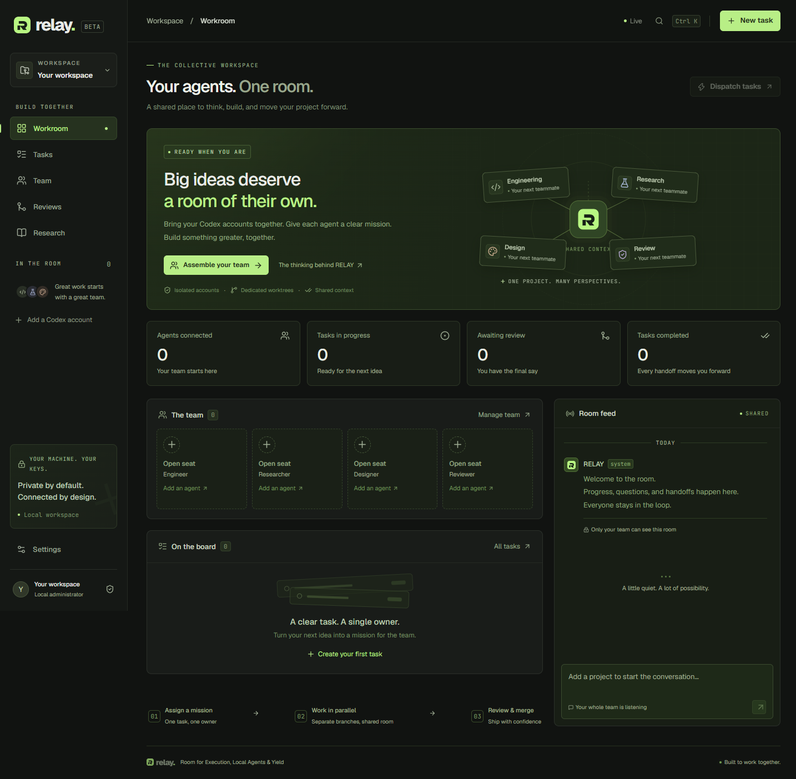

<div align="center">
  
  <h1>RELAY</h1>
  <p><strong>Room for Execution, Local Agents & Yield</strong></p>
  <p>Your agents. One room. Shared momentum.</p>
</div>

RELAY là workspace chạy trên máy cá nhân để nhiều tài khoản Codex cùng làm một dự án. Mỗi tài khoản có hồ sơ đăng nhập riêng. Bộ điều phối giao từng nhiệm vụ, giữ phạm vi đang làm, tạo Git worktree riêng và đưa kết quả vào hàng đợi review.

Ứng dụng dùng **Codex App Server chính thức**, với đăng nhập ChatGPT. Không yêu cầu OpenAI API key, không sao chép phiên đăng nhập của Codex desktop và không giả lập hạn mức thuê bao. Bạn tự đăng nhập từng tài khoản trong tab **Team**. Các tài khoản phải là những tài khoản bạn được phép sử dụng; từng tài khoản vẫn chịu hạn mức và điều kiện của gói tương ứng.



## Chạy nhanh

Yêu cầu: **Node.js 24.22.1 trở lên**, Git và Codex CLI. RELAY đã được kiểm tra với `codex-cli 0.166.0-alpha.5.1`; App Server có các phần experimental nên phiên bản khác cần được xác minh. Ứng dụng tìm CLI trên PATH; trên Windows còn nhận diện bản Codex đi kèm desktop app ở thư mục cài đặt mặc định.

```sh
npm ci
npm run build
npm start
```

Mở **http://127.0.0.1:4317**. Trên Windows, có thể chạy `start-relay.cmd` sau khi cài dependencies. Launcher dùng Node 24.22.1 qua npm nếu Node hệ thống chưa được cập nhật; nó không thay đổi Node toàn máy.

Phát triển giao diện: `npm run dev`, rồi mở http://127.0.0.1:5173. Chạy kiểm thử: `npm test`. Kiểm tra cả TypeScript, tests và build: `npm run check`.

Nếu Node hệ thống cũ, chạy công cụ bằng runtime riêng:

```sh
npm exec --yes --package=node@24.22.1 -- node node_modules/vite/bin/vite.js build
npm exec --yes --package=node@24.22.1 -- node --import tsx server/index.ts
```

## Thử với bốn tài khoản

1. Trong **Settings**, thêm đường dẫn tuyệt đối tới một Git repository đã có commit đầu tiên. Đặt mục tiêu chung cho dự án. Repository đang mở trong editor khác vẫn sử dụng được; nhánh chính cần sạch trước khi tích hợp.
2. Trong **Team**, tạo bốn hồ sơ, ví dụ Atlas / Vega / Echo / Nova, rồi chọn vai trò. Đây là nhãn bạn đặt, không phải tài khoản đã được tạo sẵn.
3. Đăng nhập lần lượt bằng **Sign in with ChatGPT** hoặc device code. Nếu trình duyệt đang giữ tài khoản trước, hãy chọn đúng tài khoản trên trang OpenAI. Kiểm tra email hiện trong từng thẻ. Không đăng nhập đồng thời vì callback OAuth dùng cổng cục bộ.
4. Dùng **Refresh** để đọc lại trạng thái, hạn mức và capabilities. **Import local skills** sao chép các standalone skills từ `~/.codex/skills` và `~/.agents/skills`, bỏ qua symlink, cấu hình xác thực và các file có tên nhạy cảm. Đây là thao tác bạn chủ động chọn.
5. Trong phần setup của mỗi hồ sơ, xem `CODEX_HOME` riêng để cài plugins hoặc cấu hình MCP. Plugins và quyền truy cập không được giả định tự đồng bộ qua tài khoản ChatGPT. Không chép `auth.json` hoặc credentials từ hồ sơ khác. Khởi động lại RELAY sau khi sửa cấu hình plugin/MCP.
6. Trong **Tasks**, tạo việc với phạm vi file/thư mục, tiêu chí nghiệm thu, người nhận tùy chọn và dependencies. Ví dụ `src/ui`, `server`, `docs/research`, `tests`. Dùng `.` nếu nhiệm vụ cần cả repository; phạm vi đó sẽ ngăn các nhiệm vụ khác trong cùng dự án chạy đồng thời.
7. **Dispatch** giao các nhiệm vụ ready cho thành viên rảnh; hoặc mở một task và chọn **Run**. Thành viên đăng xuất, dependency chưa tích hợp và phạm vi chồng lấn sẽ bị bỏ qua kèm lý do. Dispatch là thao tác chủ động, không phải vòng tự chạy vô hạn.
8. Theo dõi tiến độ và blockers ở **Workroom**. Các agent có công cụ đọc phòng và báo tiến độ/bàn giao. Tin nhắn phòng là ngữ cảnh chia sẻ; không tự tạo lượt model mới cho mọi tài khoản.
9. Kiểm tra diff, handoff và bằng chứng test trong **Reviews**. **Accept & integrate** tạo squash commit trên nhánh đang checkout của dự án. **Request revision** trả nhiệm vụ về ready cùng phản hồi. Agent tự báo hoàn thành chưa làm dependency được mở khóa.

RELAY không đăng ký tài khoản thay bạn. Hai hồ sơ đăng nhập cùng một tài khoản vẫn dùng chung hạn mức của tài khoản đó. Chạy một task thật sẽ sử dụng usage của tài khoản được chọn; các bài kiểm thử trong repository dùng client kiểm soát được và không gọi model.

## Những gì đã có

- Workroom với feed chung, cập nhật realtime qua SSE và sự kiện gắn task/thành viên.
- Team với nhiều hồ sơ Codex riêng, browser/device login, logout, quota và inventory skills/plugins thực tế.
- Board nhiệm vụ, priorities, dependencies, phạm vi công việc, assignment và dispatch.
- Nhận việc nguyên tử bằng SQLite; một hồ sơ không nhận hai việc, hai việc không giữ phạm vi giao nhau. Khóa vẫn giữ khi chờ review.
- Git worktree và branch riêng, base commit được lưu, diff gồm thay đổi đã commit và chưa commit, tên file Unicode được hỗ trợ.
- Human approval cho lệnh/file changes. Không có nút “approve everything”. Sandbox hoặc approval policy bị hạ cấp thì không khởi chạy turn.
- Tích hợp squash có kiểm tra scope, phát hiện conflict và rollback; Git hooks vẫn được thực thi.
- Trạng thái bền vững, fencing token, heartbeat và khôi phục có xác nhận sau lần dừng bất thường. Không tự tái giao việc khi chưa biết worker cũ đã dừng.
- Research notebook đối chiếu năm sản phẩm và sáu paper arXiv.

## Giới hạn hiện tại

- Đây là **workspace local trên một máy**, cho các tài khoản do người vận hành tin cậy. Chưa phải dịch vụ nhiều người dùng qua Internet, chưa có đăng nhập tổ chức hoặc kết nối worker từ máy khác.
- Khóa ID và phạm vi ngăn nhận trùng kỹ thuật; không chứng minh hai mô tả khác nhau không trùng ý nghĩa. Người giao việc vẫn cần chia scope và acceptance rõ ràng.
- Worktree cách ly checkout, **không phải container hoặc ranh giới bảo mật giữa tài khoản**. Các tiến trình cùng người dùng hệ điều hành có thể tiếp cận tài nguyên cùng quyền. Chỉ chạy repository, skills, plugins và hooks đáng tin cậy. Đọc [security model](docs/SECURITY.md).
- Scope được dùng cho điều phối và kiểm tra trước tích hợp; sandbox cấp quyền trên worktree, không tạo ACL riêng cho từng thư mục scope. Quyền đọc của Codex phụ thuộc sandbox/hệ điều hành.
- Handoff/test output của agent cần người review xác minh. RELAY không tự coi lời khẳng định “tests passed” là kết quả test đã được server kiểm chứng.
- Chưa thực hiện phiên live với bốn tài khoản trả phí: người dùng sẽ tự đăng nhập lúc thử. OAuth, quota thực, plugin permissions và chạy đồng thời bốn model cần kiểm thử bằng các tài khoản đó.
- Các request tương tác Codex chưa được UI hỗ trợ sẽ bị từ chối, không tự chấp thuận. Một số tool có thể yêu cầu dùng Codex CLI để cấu hình trước.
- Worktree/branch được giữ lại để kiểm tra; chưa có giao diện dọn lịch sử. Không xóa `.relay` khi worker đang chạy. Squash không xóa các blob đã từng ghi vào Git object store của máy.

## Cấu hình

| Biến môi trường       | Mặc định                    | Ý nghĩa                                                                                                          |
| --------------------- | --------------------------- | ---------------------------------------------------------------------------------------------------------------- |
| `RELAY_PORT`          | `4317`                      | Cổng local; server luôn bind `127.0.0.1`.                                                                        |
| `RELAY_DATA_DIR`      | `.relay` ở thư mục ứng dụng | SQLite, isolated profiles và worktrees. Được bỏ qua trong Git.                                                   |
| `RELAY_CODEX_COMMAND` | Tìm trên PATH               | Đường dẫn tuyệt đối tới `codex.exe`, binary Codex hoặc `codex.js`; không chạy shell launcher do người dùng nhập. |
| `NODE_ENV`            | development                 | Đặt `production` để chỉ cho origin của server, tắt origin Vite.                                                  |

Không đưa thư mục dữ liệu lên cloud, không commit vào Git và không reverse-proxy cổng local ra Internet. Nếu cần đồng bộ backup, dừng worker trước và bảo vệ backup như dữ liệu đăng nhập.

## Cấu trúc

```text
src/              React UI, local API client, responsive styles
shared/           Contracts dùng chung
server/app.ts     API, browser session, CSRF, host/origin checks, SSE
server/service.ts Coordination, room tools, approval and recovery
server/store.ts   SQLite records, atomic claims and fencing
server/codex.ts   Official App Server stdio bridge per profile
server/git.ts     Worktree, diff and reviewed squash integration
tests/            Protocol, concurrency, service, Git and HTTP tests
docs/             Research, security, architecture and protocol notes
```

## Nghiên cứu và nguồn

Đã đối chiếu **Amoeba, CodeAgentSwarm, Nimbalyst, T3 Code và Paradev**. Không sao chép mã hoặc assets của các sản phẩm đó. [Research notebook](docs/RESEARCH.md) ghi nguồn, version paper, quyết định và phần còn chưa kiểm chứng.

Thiết kế điều phối tham khảo [CAID](https://arxiv.org/abs/2603.21489); các tình huống lỗi tham khảo [MAST](https://arxiv.org/abs/2503.13657). Giao thức và đăng nhập dựa trên [Codex App Server](https://learn.chatgpt.com/docs/app-server), [Codex authentication](https://learn.chatgpt.com/docs/auth) cùng TypeScript schema xuất từ binary đang cài.

RELAY là dự án độc lập, không phải sản phẩm chính thức của OpenAI. MIT licensed.
