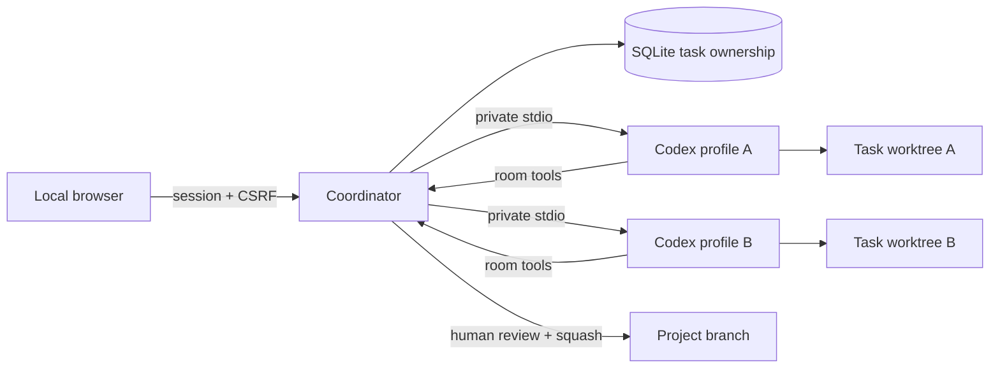

# Architecture decisions

## ADR-001: local browser UI and local coordinator

Accepted. The requested product needs access to locally installed Codex, filesystem skills, plugin configuration and Git. A React UI served by a single Node/Fastify process keeps installation small and credentials on the operator's machine. No cloud database, provider API key or paid infrastructure is needed. The trade-off is that remote teammates on different machines are not supported in this release.

## ADR-002: deterministic ownership, model-driven work

Accepted. Models implement tasks and communicate progress. SQL transactions decide who owns which task, dependency checks decide readiness, and a human decides integration. We do not spend a second model call to make a decision that a transaction can enforce. One member holds one task lease, and overlapping scopes are mutually exclusive. Semantic duplicate tasks remain a product-level judgment.

## ADR-003: App Server per account

Accepted. Each account receives its own `CODEX_HOME` and App Server process. The bridge uses the installed protocol schema and official login flows. Subscription usage remains attached to the selected account. Skills/plugins are runtime configuration; account identity alone is not sufficient to infer capability. Dynamic room tools are experimental and require protocol opt-in.

## ADR-004: completion is not acceptance

Accepted. A successful turn moves a task into review while retaining its ownership reservation. Dependencies only become runnable after explicit acceptance and integration. Review compares against a recorded base commit and uses squash integration. Retaining worktrees costs disk space but preserves evidence and makes failed merges recoverable.

## ADR-005: fail closed after uncertain termination

Accepted. A request timeout is not proof that a worker stopped. The coordinator terminates its process tree before releasing locks. Failed termination retains an orphan lease. Restart never silently steals a task. This favors correctness over automatic availability; the operator may need to confirm recovery.

## ADR-006: one host is not a hostile multi-tenant boundary

Accepted. The first release is intended for trusted accounts on one machine. A worktree is not a container. Exposing the application over the Internet or running hostile agents would require a new authentication and execution-isolation design, not merely changing the bind address.
